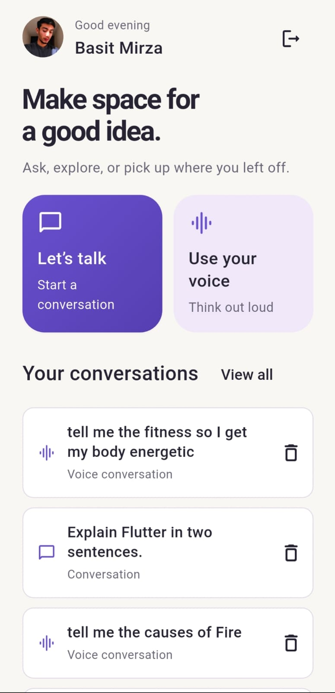
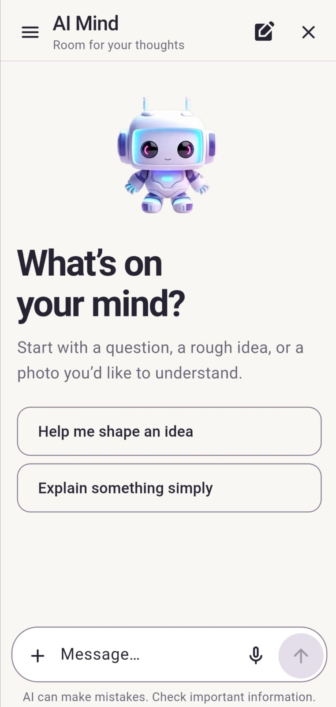
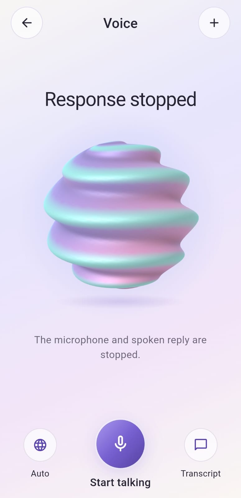
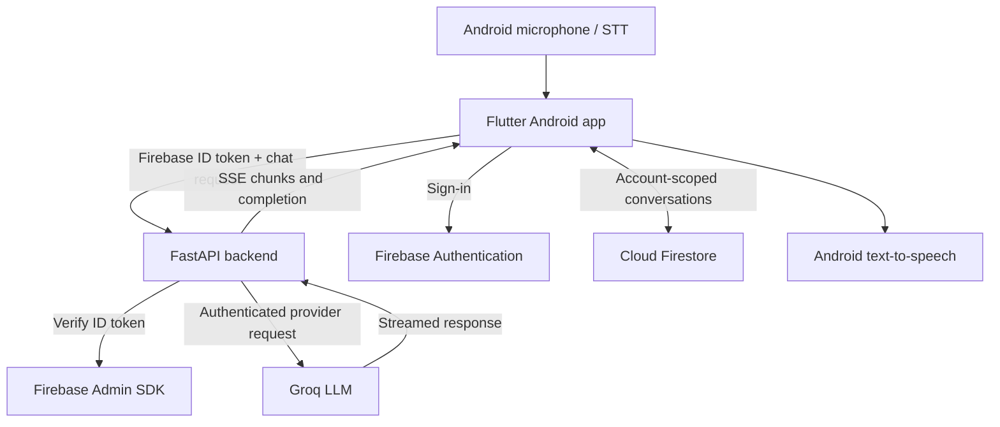

<div align="center">
  

  # AI Mind

  **A Flutter AI assistant with real-time LLM chat, voice conversations, and Firebase-backed history.**

  [](https://flutter.dev/)
  [](https://dart.dev/)
  [](https://fastapi.tiangolo.com/)
  [](https://firebase.google.com/)
  [](https://groq.com/)

  *Flutter • Dart • AI Chatbot • Voice Assistant • FastAPI • Groq LLM • Firebase • Android*
</div>

---

## Overview

**AI Mind** is an Android-tested, Flutter-based AI assistant featuring **streaming text conversations**, **turn-based voice interaction**, and **account-scoped conversation history**. A Python **FastAPI** service handles authenticated requests to **Groq**, keeping the provider API key out of the mobile app.

The interface features a warm ivory/lavender design, a compact Markdown-capable chat view, and a custom animated **Aurora Orb** that reflects voice-session states. This is a **developer portfolio project**; it requires separately configured Firebase and server credentials and is **not a hosted, publicly available AI service**.

## App preview

<table>
  <tr>
    <td align="center"></td>
    <td align="center"></td>
    <td align="center"></td>
  </tr>
  <tr>
    <td align="center"><b>Dashboard</b></td>
    <td align="center"><b>Text chat</b></td>
    <td align="center"><b>Aurora Voice</b></td>
  </tr>
</table>

> Screenshots show the tested Android interface. The app uses a locally hosted development backend; no public backend endpoint or live demo is provided here.

## Highlights

- **Streaming LLM chat:** Incremental Groq responses delivered through an authenticated FastAPI server using Server-Sent Events (SSE).
- **Readable answers:** Markdown headings, lists, tables, inline code and copyable code blocks; supports long responses and token-limit continuation.
- **Conversation tools:** New conversations, search and paginated history, copy, retry, regenerate and Stop controls.
- **Voice assistant:** Android speech recognition → Groq-generated response → Android text-to-speech, with session controls and contextual follow-up turns.
- **Aurora Orb experience:** A lightweight, state-driven animated voice visualization for listening, processing, speaking and idle states.
- **Firebase identity:** Email/password and Google sign-in, with AI requests restricted to authenticated sessions.
- **Conversation persistence:** Firestore-backed account-scoped messages, restored across app restarts.
- **Defensive request handling:** Streaming completion classification, cancellation guards, bounded errors, and safe handling of interrupted responses.

### Feature availability

| Feature | Status |
| --- | --- |
| Text chat and SSE response streaming | Implemented and tested on Android |
| Speech recognition and spoken answers | Implemented and tested on Android |
| Saved conversation history | Implemented and tested on Android |
| Firebase account authentication | Implemented |
| Image/vision analysis | Backend groundwork; disabled by default pending provider/account validation |
| Hosted production service / public APK | Not provided |
| iOS testing | Not claimed |

## Technology stack

| Layer | Technologies |
| --- | --- |
| Mobile UI | Flutter, Dart, Material widgets, custom animation/painting |
| Text generation | Groq inference through FastAPI (configurable backend text model) |
| API backend | Python, FastAPI, Pydantic, HTTP streaming/SSE |
| Identity | Firebase Authentication, Firebase Admin SDK token verification |
| Persistence | Cloud Firestore |
| Voice input/output | Android speech recognition (`speech_to_text`), Android TTS (`flutter_tts`) |
| Testing | Flutter tests, Python/pytest, Firestore emulator security tests |

## Architecture



**Security boundary:** The mobile app never embeds a Groq API key. The private provider key and Firebase Admin credential belong only to the locally configured backend (or a properly secured server deployment). Firebase client configuration is separate from Firebase Admin credentials.

## Getting started (local development)

### Prerequisites

- Flutter SDK and an Android development environment
- Python 3.11+ and `pip`
- An Android test device with USB debugging enabled
- An existing Firebase project configured for the Flutter application
- A **new, private** Groq API key and Firebase Admin credentials stored **outside this repository**

> Configuration paths, Android package identifiers, and Firebase service setup must match your own project. The repository does **not** contain working private credentials.

### 1. Flutter dependencies

```bash
flutter pub get
flutter analyze
flutter test
```

### 2. Backend dependencies

```bash
python3 -m venv backend/.venv
backend/.venv/bin/python -m pip install -r backend/requirements-dev.txt
cp backend/.env.example backend/.env
chmod 600 backend/.env
```

Edit `backend/.env` **locally**. Required values include:

| Variable | Purpose |
| --- | --- |
| `GROQ_API_KEY` | New private Groq API key; never commit |
| `GROQ_TEXT_MODEL` | Backend-configured text model (tested configuration: `openai/gpt-oss-120b`) |
| `FIREBASE_PROJECT_ID` | Existing Firebase project ID |
| `GOOGLE_APPLICATION_CREDENTIALS` | Absolute path to your private Firebase Admin JSON **outside the repository** |

Keep optional vision features disabled unless their specific model access and safety have been validated. Do not use the old compromised provider key.

### 3. Start FastAPI

```bash
backend/.venv/bin/python -m uvicorn app.main:app \
  --app-dir backend --host 127.0.0.1 --port 8000 --no-access-log
```

In another terminal, check the local health endpoint:

```bash
curl -i http://127.0.0.1:8000/health
```

### 4. Android USB testing

Run the following in a separate terminal, replacing `<device-id>` with your own ADB device ID:

```bash
adb -s <device-id> reverse tcp:8000 tcp:8000
flutter run --debug -d <device-id> \
  --dart-define=AI_MIND_BACKEND_URL=http://127.0.0.1:8000
```

**Important:** This `http://127.0.0.1` URL is intended only for a USB-forwarded **debug session**. A hosted production application requires an HTTPS backend, secure key management, production-grade quotas and an independent security review. A standalone install without the appropriate backend will not provide AI responses.

## Testing

```bash
# Flutter
flutter analyze --no-pub
flutter test

# FastAPI/backend
backend/.venv/bin/python -m pytest -c backend/pytest.ini backend/tests -q

# Optional Firestore Rules emulator test suite, if Node/Firebase CLI are installed
cd security_tests
npm install
npm run test:emulator
```

The Android text and voice flows have been exercised on a Vivo Android 12 test device. Automated test counts change as the project evolves; inspect current CI/local results for up-to-date totals.

## Responsible deployment

This repository is a **source-code and portfolio showcase**, not a production hosting offer. Before a production release, validate/deploy account-isolating Firestore Security Rules, enforce durable server-side rate limits and quotas, enable monitoring and secure HTTPS deployment, rotate previously exposed keys, and audit the final release artifacts. The development in-memory quota store is **not suitable for multi-instance production enforcement**.

Please do not commit `.env` files, Firebase Admin service-account JSON, old credential-bearing Git history, Android signing keys, local logs, recordings, or private design references. See [Security notes](docs/SECURITY.md).

## Project structure

```text
lib/                 Flutter screens, services and UI logic
android/             Android platform configuration
assets/              App images and bundled resources
backend/app/         FastAPI and Groq integration
backend/tests/       Python API and streaming tests
test/                Flutter tests
security_tests/      Firestore emulator rules tests (if present)
docs/screenshots/    Public-facing product screenshots
docs/branding/       Public-facing mascot art
```

## Author

Developed by **Abdul Basit** — Flutter Developer | AI/ML & Computer Vision.

- [GitHub](https://github.com/BasitMirza0)
- [LinkedIn](https://www.linkedin.com/in/basit-mirza/)

## License

No open-source license has been selected for this repository. The code is publicly viewable, but reuse rights are not granted by default. The author may add a license later. Third-party packages, fonts, and assets retain their own licenses.
